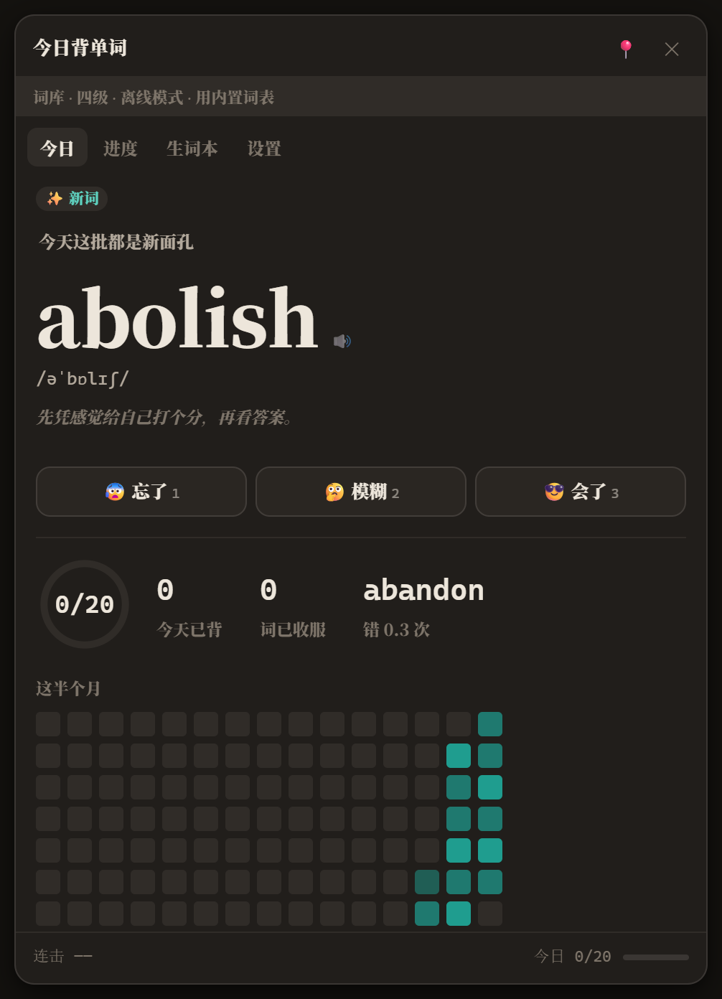
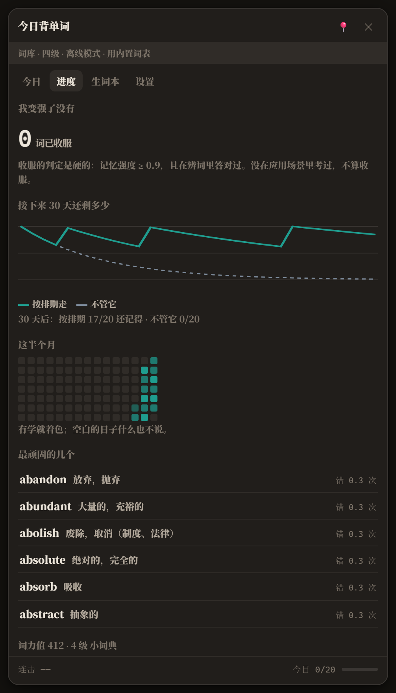
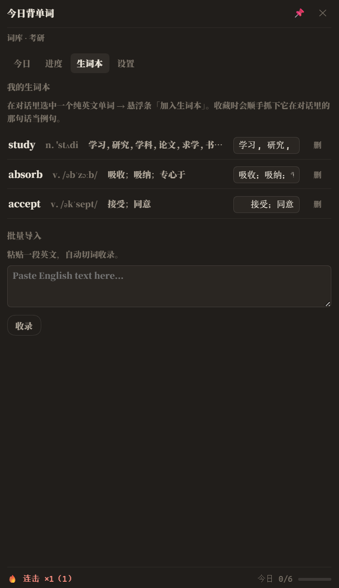
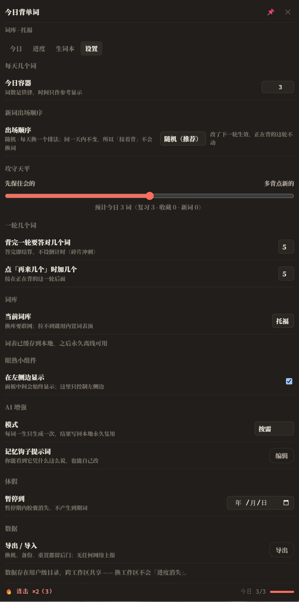
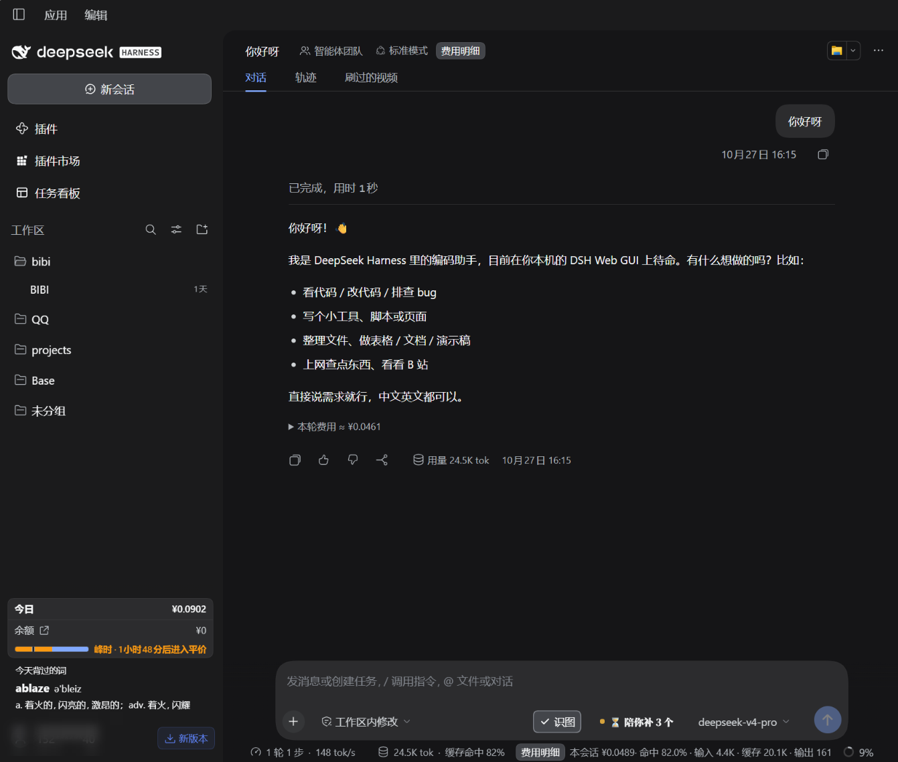
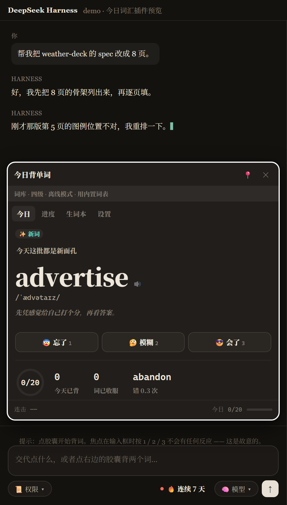
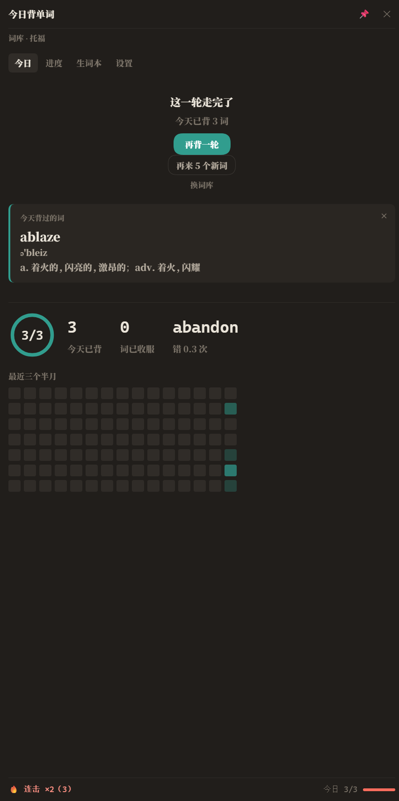

# 今日词汇 · dsh-vocab-study

DSH（DeepSeek Harness）的一个**纯客户端 UI 插件**：在输入框右边放一颗胶囊，点开就是一个背单词面板。

数据只存在你自己的浏览器里，不上报、不联网、不占 Host 服务。

**不装插件先看效果**：[`demo/index.html`](demo/index.html) 双击就开，纯本地。

<p align="center">
  
  
  
  
</p>

---

## 目录

| 想干的事 | 去哪看 |
|---|---|
| 看它长什么样、有什么功能 | [它长什么样](#它长什么样) |
| 不装插件先试试 | [demo/index.html](demo/index.html) 双击打开 |
| 装进 DSH / 卸载 / 出问题自救 | [装进 DSH](#装进-dsh) |
| 生词本：收录的词怎么自动有了释义 | [生词本](#生词本收录的词会自动补上释义) |
| 搞懂它内部怎么组织的 | [它是怎么工作的](#它是怎么工作的) |
| 跑测试 | [测试](#测试) |
| 它承诺不做什么（12 条硬约束） | [12 条硬约束](#12-条硬约束) |
| 它现在**还做不到**什么（诚实清单） | [已知缺口](#已知缺口诚实清单) |
| 开发中踩过的坑（14 个事故） | [docs/INCIDENTS.md](docs/INCIDENTS.md) |

---

## 状态

| 项 | 说明 |
|---|---|
| 版本 | `0.3.3`（[Releases](https://github.com/wt0812/dsh-vocab-study/releases)） |
| 成熟度 | 功能可用、**在真界面里逐条点过**；13 套件 / 约 600 条断言全绿（详见[测试](#测试)） |
| 依赖 | **零**。没有 `node_modules`，不联网、不上报，数据只在本机浏览器里 |
| 体积 | `lib/client.js` 5,677,324 B ≈ **5.41 MB**（内含六本词库共 **34,216** 词，见[为什么这么大](#构建)） |
| 装法 | `dsh plugin --profile web add dsh-vocab-study`（npm，推荐）<br>或 `dsh plugin --profile web add github:wt0812/dsh-vocab-study` |
| 国内镜像 | [gitee.com/wutong2005/dsh-vocab-study](https://gitee.com/wutong2005/dsh-vocab-study)（**与 GitHub 逐提交一致**，见下） |
| 市场收录 | 已被第三方市场 dshmarket **收录**（[PR #7043](https://github.com/awesome-dsh-plugin/awesome-dsh-plugin/pull/7043) 于 2026-10-17 合并） |
| 已知缺口 | 见[已知缺口](#已知缺口诚实清单)（8 条，含"未在真实网络环境验证词库拉取"这种） |

### 国内镜像（Gitee）

GitHub 在国内时常连不上，所以有一份 Gitee 镜像：**https://gitee.com/wutong2005/dsh-vocab-study**

它和 GitHub **逐提交一致**（HEAD sha 相同，全部提交 + 标签都在）。
我在两边的克隆里各跑过 13 个套件（605 条断言），都是 0 失败。

从 Gitee 装的做法是「先克隆，再装本地目录」（`dsh plugin` 没有 `gitee:` 这种形态）：

```powershell
git clone https://gitee.com/wutong2005/dsh-vocab-study.git
cd dsh-vocab-study
python tools/install.py
```

`install.py` 默认装到 `desktop`（桌面客户端）。要装进浏览器 Web 界面那套 profile，
把脚本里的 `DEFAULT_PROFILE` 指到 `web` 下的同名目录。

> **镜像不是自动同步的**，是我推的。一切以 GitHub 为准。

> 「成熟度」这一行我写得很克制：**能用**是真的（你亲手点过），
> 但它是 0.3.3、只有一个人在用、只有一台机器验过 —— 不是"生产级"。

---

## 它长什么样

**① 输入框旁那颗胶囊**（`conversation.input.right`，排在「权限」与「模型」之间）：



> 整个工作区的截图：左边栏底部那张「今天背过的词 ablaze」是 0.3.1 加的眼熟小组件，
> 右边是它在对话里怎么被用起来。词库选的是托福，所以一轮只有 3 个词。

**② 右侧栏里的面板 · 卡片背面**（`sidebar.right.pane.tab`，四个页签：今日 / 进度 / 生词本 / 设置）：



> 这张特意截的是背面 —— 常见搭配、词根词缀、词源、同族词、例句，
> 0.2.8 之后卡片才逐项加上这些（`abject`，五项全在）。

| 位置 | 内容 |
|---|---|
| `conversation.input.right` | 一颗胶囊 `今天第一词`，排在「权限」与「模型」之间 |
| `sidebar.right.pane.tab` | 一个叫「今日背单词」的标签页，四个页签：今日 / 进度 / 生词本 / 设置 |

> **截图**：上面两张图就在 `assets/` 里（`screenshot-1-capsule.png`、`screenshot-2-panel.png`），
> 同时由 `screenshots.json` 声明，市场详情页会用同一份声明
> （上游 `probe-screenshots.mjs` 从仓库 HEAD 实时读取，不需要另外提 PR）。

### 四个页签各自的样子

上面那两张是"它长在哪"；下面这四张是**它长什么样** —— 每个页签一张，都是把面板展开到内容结束拍的整图：

| 页签 | 一句话 | 图 |
|---|---|---|
| **今日** | 一张词卡 + 三档评分；下方是今天这批的进度环、KPI、半月热力图 |  |
| **进度** | 30 天留存曲线、半月热力图、顽固词榜、需要对着练的混淆对 |  |
| **生词本** | 从对话里收的词，**自动补上音标 + 词性 + 释义**，可以手改 |  |
| **设置** | 一轮几个词、加量步长、攻守天平、数据导入导出 |  |

> 这四张图是 `node tools/make-releasshots.mjs` 出的，脚本自带两道闸门（裁切区里只能有面板和背景、
> 产出图四角必须是背景色），拍错了会直接报错拒绝出图。

不用它的日子它什么都不做。面板**永远不会自己弹出来**（这是刻意的，见下面「12 条硬约束」）。

### 背完一轮之后（不是死角）

一轮走完时不再只剩一个「换词库」，而是给三条**各自不同**的出路：

| 控件 | 做什么 | 什么时候出现 |
|---|---|---|
| **再背一轮** | 把刚才这一批**原样重来一遍**（不动记忆数据，不算新词） | 这一轮有内容可重背时 |
| **再来 N 个新词** | 往后加量：容器扩大，接在队列后面，**不重复**（N 在设置里可调，默认 5） | 新词闸门开着时 |
| **我还是想继续** | 打开新词闸门（安全阀仍然自动触发，只是给了用户自己开门的权力） | 闸门**自动关闭**时 |
| 换词库 | 换一本词库 | 始终有，但降到最弱的样式 |

两个容易搞混的数字，故意分开：

- **进度环** = **这一轮**（`0/20` → `5/20` → 走完 `5/20`），点「再背一轮」后归零；
- **今天已背** = **今天累计**（KPI 里第一个，抽空背 3 个也看得见），跨轮累加、不归零。

> 为什么拆开：环原来用的是跨轮累加的值，点了「再背一轮」之后环显示上一轮的数字，
> 和「今天已背」互相矛盾（实测：环说 1、今日说 6）。用户会以为数字坏了。

「再来 N 个」的 **N 可以自己定**（设置页「点「再来几个」时加几个」，3 / 5 / 10，默认 5）——
加量是用户的决定，不该由插件自作主张定死一个数（P4）。

**新词安全阀**（规格 §7.6）：今天新词错得太多时自动停新词。这是安全阀不是拦路虎 ——
它仍然自动触发，但界面上给一个「我还是想继续」，用户自己决定要不要开。



> 走完不是空白页：上面写清这一轮走完、今天已背几个词，下面把**今天背过的词**列出来，再给三条出路。
> （这张和上面两张一样是真界面截图；其余四张是脚本从 demo 里拍的。）

---

## 生词本：收录的词会自动补上释义

在对话里选中一个纯英文单词，输入框旁会出现「加入生词本」。点了之后：

| 它做什么 | 说明 |
|---|---|
| **自动补音标 + 词性 + 释义** | 从内置的 29,841 词里**离线**查一遍（`lookupWord`），命中就填上 |
| **顺手抓例句** | 把你在对话里选中它的那句话存下来当例句 |
| **查不到就留空并说明** | 生词本上标「（还没释义）」，并给一个手填输入框 —— 不编造（P7） |
| **手填的会标来源** | 自己填的释义标 `manual`，查到的标 `lookup`，一眼看得出哪个是它自己查的 |

**「收服」的意思是：这个词真的记住了，就不该再占着生词本。**
所以判定为收服（记忆强度 ≥ 0.9 **且**拼写答对）之后，它会**自动从生词本移走**，
但不会凭空消失 —— 进「已收服 N 个」的归档，带时间戳，随时能查。

> 这一条以前是坏的：收录进来的词**永远没有释义**，生词本是个空壳 ——
> 因为只有几万条释义摆在旁边，代码里却**根本没有查询动作**。
> 症状 → 根因 → 修法见 [排查笔记 · 事故十三](docs/INCIDENTS.md)。

**不熟的词不给提示？给。**
今天错过的词会攒起来，生词本页顶上有一条提示问你要不要一起收进去 ——
但**它只是提示，不会自动加**：加什么进你的生词本是你的决定（P4）。

---

## 想先看效果，不装插件

```powershell
# 双击即可，纯本地，不需要装任何东西
start demo\index.html
```

`demo/` 是一个自包含的演示页：里面有一个假的 DSH 外壳（对话区 + 输入框 + 工具栏），
胶囊和面板都是**同一份源码**编译出来的，不是另写的仿制品。

`demo/` 里的几个文件：

| 文件 | 用途 |
|---|---|
| `index.html` | 打开就是这个 demo，可以真的点着背 |
| `smoke.html` | 自检页：外壳 11 项检查 + core 自检，全绿才算过 |
| `preview.html` | 直接截到「词卡」态（未揭晓） |
| `preview-reveal.html` | 截到「已揭晓」态 |
| `preview-progress.html` | 截到「进度」页 |
| `preview-settings.html` | 截到「设置」页 |
| `preview-vocab.html` | 截到「生词本」页 |
| `preview-hook.html` | 截到「记忆钩子」相关态 |

`preview*.html` 只是为了截图/看态方便，它们会在打开后自动点开对应页签。

---

## 装进 DSH

### 给别人用

```sh
# 推荐：从 npm 装（快，国内有镜像）
dsh plugin --profile web add dsh-vocab-study

# 或者从 GitHub 源码装（npm 上不去时用）
dsh plugin --profile web add github:wt0812/dsh-vocab-study
```

装完 **完全退出 DeepSeek Harness 再打开**（`cordis.patch.yml` 是启动时读的，刷新页面没用）。

**关于 `--profile`，这是最容易搞错的一处 —— 上面这两种写法就是对的。**

`dsh plugin` 是命令行工具，它把后面的参数**原样转发给 profile 目录里的 pnpm**
（读的是 DSH 本体的命令定义：「manage a profile's plugins by forwarding the
remaining arguments to pnpm in the profile directory」），其中 `--profile` 是**必填项**。

⚠️ **不要写 `--profile desktop`** —— 那会直接报错：

```
error: profile "desktop" is managed exclusively by the Electron application
```

读自 DSH 本体的启动器（`rejectElectronProfile`）：`desktop` 这个 profile 名
**保留给 Electron 应用独占管理**，CLI 拒绝针对它的 `plugin-management`。
所以**桌面客户端用户也用 `--profile web`** —— 你桌面 App 一直用的就是
`profiles/desktop` 那个目录，**是 App 自己写进去的，不需要你手动装进去**。
`dsh plugin --profile web add ...` 写的是 `profiles/web`，你平时打开的那个 Web
界面（以及桌面版内嵌的那个）都读它。

> 市场目录里 4481 条条目的 install 命令**全部**是 `--profile web` —— 跟这里一致。

**不需要 npm 命令行工具、不需要构建、不需要 Python。** 从 npm 装时 pnpm 会去
registry 拉包；从 GitHub 装时 `lib/` 里的产物已经提交进仓库，装完就能用。

卸载：

```sh
dsh plugin --profile web remove dsh-vocab-study
```

> **它不联网、不上报。** 背单词的数据只落在你浏览器自己的 `localStorage` 里，插件不注册任何 Host 服务，
> 也不发一个网络请求（音标朗读用的是系统 TTS，不是在线服务）。唯一声明的能力是往两个槽位里画东西。

### 自己改代码用：本机脚本

想改源码、看完再装，用仓库自带的脚本（幂等，坏了重跑一次就能修好）：

```powershell
# 1. 构建产物（lib/client.js 是插件本体，lib/index.js 是 host 占位入口）
python tools/build.py
python tools/build-plugin.py

# 2. 安装（改 profile 的 package.json 与 cordis.patch.yml）
python tools/install.py
```

想看它会做什么而不动任何文件：`python tools/install.py --dry-run`。

> ⚠️ 这个脚本里的路径是**本机绝对路径**，只适合作者自己用。
> 给别人装请用上面的 `dsh plugin` 命令。

### 卸载

```powershell
python tools/uninstall.py            # 只想看会做什么就加 --dry-run
```

**卸载前必须完全退出 DeepSeek Harness**，否则 `node_modules` 里那份被正在运行的进程
占着删不掉（脚本会明确报 `✗ 删不掉` 并以退出码 1 结束，不会假报成功）。

卸载只动属于本插件的东西：`node_modules\dsh-vocab-study`、`package.json` 里的
两条登记、`cordis.patch.yml` 里的一段。**其它插件的条目一个都不碰**（脚本每次都会
打印其余 bundles 清单让你核对），本仓库的源码/测试/demo 也一个都不删。

### 为什么必须「完全退出」而不是刷新页面

`cordis.patch.yml` 是**启动时**读的，客户端模块清单也在启动时扫描并缓存
（客户端半身的机会只有启动那一次）。只按 F5 不够 —— 现象就是「装了、重启了、
界面上什么都没有」。而 `lib/client.js` 的字节变化在刷新后是能生效的（走 `?rev=`），
所以**改了插件代码只要刷新；改了 `cordis.patch.yml` 必须重启**。

### 万一重启后客户端起不来了（自救）

如果重启后**整个客户端停在启动页**、弹窗写着「DeepSeek Harness 无法使用」，
按弹窗那个「禁用第三方插件」按钮就能恢复（它会备份 profile patch 再禁用）。
然后**完全退出 DSH**，在本仓库里跑：

```powershell
python tools/uninstall.py     # 卸干净，回到装之前的状态
```

或者临时只改 `cordis.patch.yml`：把末尾 `- id: vocab-study` 那一条删掉（**必须完整重启**）。

这个问题曾经真实发生过一次，根因与修法见 [排查笔记 · 事故二](docs/INCIDENTS.md)。
装插件前跑一遍 `python tools/install.py --dry-run` 可以确认不会动到别的插件。

### 换用 dsh plugin 命令也可以

```powershell
# 装本机这个开发目录（注意不是 --profile desktop，那个 CLI 会拒绝）
dsh plugin --profile web add "F:\DeepSeek Harness\projects\vocab-study"
```

但它有两个已知副作用，所以本仓库默认用 `tools/install.py`：

1. 它可能把安装位做成**真实副本**而不是联接（于是以后重建产物到不了插件目录）；
2. 它在管理界面里点「停用」会往 `cordis.patch.yml` 写 `disabled: true`，而且
   **点「启用」不会删掉那一行** —— 那种状态下 Host 侧显示 `enabled: true /
   fiberPhase: active`，但客户端半身永远不加载。

`tools/install.py` 每次都会把这两件事纠正过来（重建联接、清掉 `disabled`）。

### 手动安装（不想用 dsh plugin 命令）

**关键：一定要用联接（junction），不要复制文件。** 原因见下面「最大的坑」。

```powershell
$profile = "C:\Users\<你>\.dsh\profiles\desktop"
$src     = "F:\DeepSeek Harness\projects\vocab-study"

# 用联接，不要 Copy-Item
cmd /c mklink /J "$profile\node_modules\dsh-vocab-study" "$src"

# 然后往 $profile\package.json 里补：
#   dependencies: { "dsh-vocab-study": "file:F:/DeepSeek Harness/projects/vocab-study" }
#   dsh.profile.bundles 数组末尾加 "dsh-vocab-study"
```

### 最大的坑：profile 里那份可能是「副本」，不是「联接」

`pnpm install` 装 `file:` 依赖时，**可能把包复制成真实目录**，而不是建联接。
一旦是副本，你在源码目录里 `python tools/build-plugin.py` 重建，
**profile 里那份永远不会变** —— 现象就是「改了没反应、刷新也没用」，
而所有测试又是绿的，非常难查。

**判断方法**（PowerShell 的 `LinkType` 属性不可靠，用 fsutil 或 Node）：

```powershell
fsutil reparsepoint query "$profile\node_modules\dsh-vocab-study"
# "不是重解析点" / "not a reparse point"  → 是副本，下面的坑就在你身上
```

```javascript
// 或者用 Node（最准）
const fs = require('fs');
fs.lstatSync(path).isSymbolicLink();     // junction 在 Windows 上也算 true
fs.realpathSync(path);                   // 指向源码目录 = 联接；指向自己 = 副本
```

**修法**：删掉副本目录，改建联接（本节顶部那行 `mklink /J`）。

**每次重建后自检**（两边大小必须一致）：

```powershell
(Get-Item "$src\lib\client.js").Length -eq (Get-Item "$profile\node_modules\dsh-vocab-study\lib\client.js").Length
# True = 一致（联接正常）；False = 你在看一份旧副本
```

### 第二个坑：插件管理器写的 `disabled: true` 清不掉

在插件管理界面里点「停用」，它会在 profile 的 `cordis.patch.yml` 里写下：

```yaml
- id: vocab-study
  disabled: true
```

**然后在界面里点「启用」并不会删掉这行。** 插件会一直处于停用状态：
Host 侧看起来是 `enabled: true / active`（因为运行时的树还记得启用过），
但**客户端半身永远不加载**，现象就是「装了、重启了、界面上什么都没有」。

**修法**：手动删掉那两行。文件末尾留一条注释提醒自己。

另外注意：`cordis.patch.yml` 是**启动时读取**的，改完必须**完整重启 DSH**
（刷新页面没用——客户端清单在启动时就扫描完了）。

---

## 它是怎么工作的

### 三层结构，界面与逻辑严格分开

```
core/      纯逻辑。零宿主依赖，可跨环境运行（Node 里直接跑单测）
  memory.mjs    半衰期记忆模型（HLR）：多久会忘、什么时候该复习
  mistake.mjs   错因诊断、形近词混淆、永久拉黑
  queue.mjs     今日容器：三层配额（复习/收藏/新词）、断签缩量、连续打卡
  game.mjs      连击倍率、等级、收服计数
  beckon.mjs    「该不该招呼你」的状态机（第一词/好久不见/到期/学词中/交接…）
  session.mjs   一次学习会话：轮次、同轮重训、撤销、拼写测验
  library.mjs   词库：内置种子 / 剪贴板解析 / 降级到内置词表
  seed-cet4.mjs 四级内置词表的手写部分（116 词，带人工例句/译文/搭配/词根）
seed-cet4-extra.mjs 四级内置词表的补全部分（4,375 词，来自公开四级词表，见 tools/make-cet4-extra.mjs）
  seed-exams.mjs 六级/考研/雅思/托福/GRE 内置词表（生成的，见下）
  speech.mjs    系统语音朗读（不支持就静默跳过，不影响背词）
  app.mjs       把它们缝起来，对外只暴露一个 createApp(ports)
  spec-cases.mjs 共享验收用例（demo 与 Node 单测跑的是同一套断言）

> **关于内置词表**：`seed-exams.mjs` 是**生成产物**（2.53 MB，29,841 词），
> 由 `tools/make-seeds.mjs` 从 [ECDICT](https://github.com/skywind3000/ECDICT)
> （MIT）按考纲 `tag` 筛出来。不要手改，改词表就重跑那个脚本。
>
> 为什么要有它：这五个词库的远程词表取不到时要能降级，而且降级内容
> **必须各不相同**。以前 `seedFor()` 是把四级那 116 个词换个 id 前缀
> 冒充六级/雅思 —— 那是假数据，比"词表为空"更坏（空的用户知道不对，
> 假的用户不知道，而且 id 前缀一变，学习记录全部对不上）。
>
> 代价是客户端产物从 314 KB 涨到约 4.37 MB。这是**用体积换离线可用**的
> 明确取舍，不是意外。

store/
  client-store.mjs  浏览器持久化：多窗口只读锁 + 配额降级（不阻塞）

ui/         界面。只依赖 core 的命名空间，不依赖任何 UI 框架
  dom.mjs       极小的 DOM 工具（el / mount / setText …）
  pages.mjs     进度页、生词本页、设置页的渲染
  panel.mjs     整个面板：四个页签、键盘快捷键、卡片交互
  capsule.mjs   输入框右边那颗胶囊
  styles.css    所有样式，类名与 CSS 变量统一带 vs- 前缀，不会跟宿主打架
  shell.mjs     演示用的假 DSH 外壳（**不属于插件**，只有 demo 用）

adapter/dsh/  插件适配层
  puppet.mjs   把 core + ui 组装成「胶囊」和「面板」两个傀儡
  client.js    真正的 DSH 客户端入口：占槽位、注册标签页
```

### 命名空间：界面层怎么拿到 core

单文件产物把所有文件摊平进同一作用域，ESM 绑定全部消失；插件入口又只能 `require('react')`，
不能 import 自己人。所以界面层拿 core 的唯一通道是 `ui/core-ref.mjs` 的注册表：

```js
// ESM 形态（Node 单测）：ui/pages.mjs 自己登记
setCore({ memory: M_, mistake: MK_, game: G_, queue: Q_, library: L_, beckon: B_ });

// 摊平形态（构建产物）：构建脚本按 CORE_EXPORTS 统一登记
setCore({ memory: { newMemory, encode, ... }, mistake: { ... }, ... });
```

读的时候**键名只有全名**，单字母只能当别名：

```js
const { queue: Q } = getCore();   // ✅
const { Q } = getCore();          // ❌ Q 是 undefined（构建期就会报错拦下）
```

这个坑真的踩过：设置页报 `Q.buildDailyContainer is not a function`。
现在两个构建脚本都会扫描这种写法，构建期直接失败，不会留到运行时。

### 构建

```powershell
python tools/build.py          # → demo/（自包含 HTML，双击可开）
python tools/build-plugin.py   # → lib/client.js + lib/index.js（真正装进 DSH 的产物）
```

两个脚本读的是**同一份源码**，没有手抄的核心逻辑。

**构建是确定性的**：同一份源码构建两次，产物**逐字节相同**（`lib/` 和 `demo/` 都是）。
产物头里那行构建时间取的是 `core/` 与 `ui/` 里最新的源码修改时间，不是 `datetime.now()`；
也可以用标准的 `SOURCE_DATE_EPOCH` 环境变量覆盖它。

这一条不是洁癖，它让「提交的产物是不是最新的」**可以被机器验证** —— CI 里重新构建一次，
只要有 diff 就红。以前时间戳是 `now()`，这条检查永远是假红，等于没做。

`build-plugin.py` 会：
1. 剥掉所有 import/export（除 `react` 外任何可注册的默认导入都会让构建失败）
2. 把 core 里的 `Q.dayKey(...)` 改写成裸符号名 `dayKey(...)`（摊平后没有命名空间对象）
3. 把 CSS 包成字符串 + `injectVocabStudyCss()`
4. 用真的 `node --check` 验证语法
5. 检查符号清单、重名、`getCore()` 键名、ESM 别名残留

---

## 测试

```powershell
python tools/build.py && python tools/build-plugin.py
node test/core.test.mjs
node test/roots.test.mjs
node test/weekly-report.test.mjs
node test/plugin.test.mjs
node test/demo-boot.test.mjs
node test/client-activation.test.mjs
node test/bundle-audit.test.mjs
node test/mount.test.mjs
node test/round-control.test.mjs
node test/multi-conversation.test.mjs
node test/examples-etym.test.mjs
node test/collocations.test.mjs
```

| 测试 | 覆盖什么 | 当前 |
|---|---|---|
| `test/core.test.mjs` | 共享验收用例 20 组 + 种子数据、字段名一致性等体检 + **记忆钩子 12 项** + **新词顺序 13 项** + **收录自动补释义 / 不熟的给提示 / 收服自动归档 / 加量可设（含"不许白屏"的双向登记守卫）** | **106 通过 / 0 失败**（85 汇总 + 21 健全性附加检查） |
| `test/roots.test.mjs` | 词根词缀数据表自洽 + 查询层 + 两条数据入口（远程词表 / 内置种子）：拆解必须能看出词素、来源必须能看出出处，查不到就是 null，绝不硬编 | **82 通过 / 0 失败** |
| `test/weekly-report.test.mjs` | 周报：跨周、跨月、跨年、时区、空数据、只有新词没有复习词等边界 | **26 通过 / 0 失败** |
| `test/plugin.test.mjs` | 假宿主：槽位契约、胶囊顺序、key 一致性、组件可实例化、样式只注入一次、**真的点一次胶囊并断言走到了 `openTabIn`**（见事故四） | **33 通过 / 0 失败** |
| `test/demo-boot.test.mjs` | 最小 DOM 里真的跑一遍 demo 产物：外壳建起来、四个页签逐个点开、**真的点一次「✨ 让我记住它」并检查输出非空**、**真的拨一次「出场顺序」开关并检查设置变了**、**真的走一遍新功能（收录→补释义→不熟提示→收服归档→改加量）** | **62 通过 / 0 失败** |
| `test/client-activation.test.mjs` | **真的把 `lib/client.js` 跑起来**：注册 → 物化工厂 → 检查导出 → **调 `apply(ctx)`** → 断言注册了哪些槽位。守的是"插件能不能被宿主激活" | **18 通过 / 0 失败** |
| `test/bundle-audit.test.mjs` | 产物静态审计：只有 1 处 `load()`、只 `require('react')`、`inject` 声明齐全、没有"未声明服务上的裸方法调用"、`openVocabTab` 的契约（见事故三、四）、**宿主容器能撑开面板 + 限宽居中不被 margin 简写清零**（见事故五） | **28 项全过** |
| `test/mount.test.mjs` | **真的把界面画出来并断言节点进了 DOM 树**：从产物里抠出傀儡工厂 → 拿真容器建一遍 → 断言容器里真的有 `.vs-panel` / `.vs-capsule`。守的是"注册成功了但屏幕上是空的"（见事故三）。第 ⑤ 节守**播放键不是死键**（见事故六） | **33 通过 / 0 失败** |
| `test/round-control.test.mjs` | 「背完一轮之后」的三条出路：今日已背计数、再背一轮、往后加量、安全阀（自动触发 + 用户放行）、跨天重置，**三个只有真点一遍才发现的 bug 的回归锁**，第 ⑧ 节**换词库必须真的把词换掉**（见事故七），第 ⑨ 节**设置要留痕**，第 ⑩ 节**用真实存储件测写入/读取对称**（见事故九 —— 这节的绿必须是真绿，因为前两节用的替身把它屏蔽过），第 ③.5 节**「再来 5 个新词」不许重考刚背过的**（见事故十 —— 断言的是"下一张卡是谁"，不是容器自己的属性） | **107 通过 / 0 失败** |
| `test/multi-conversation.test.mjs` | **两个对话必须共用同一个内核实例**（见[事故十一](docs/INCIDENTS.md)）。物化真产物 → 拿真注册的胶囊组件 → 用假 React 挂两次（`conv-a` / `conv-b`）→ 断言两次拿到的是**同一个 app**，再从一个对话改设置、验证另一个立刻看到。第 ③ 节只做不会误报的结构断言 | **13 通过 / 0 失败** |

| `test/examples-etym.test.mjs` | 例句（Tatoeba）+ 词源（Wiktionary）：每条英文必须是 3–14 词的完整句子且含目标词、中文必须简体、**译文允许为 null（英文单语）但绝不编造**、台版用词 = 0、词源必须分清「拆解」与「来源」 | **37 通过 / 0 失败** |
| `test/collocations.test.mjs` | 常见搭配：形态自洽、**精度回归**（上一版 `fish is` / `better consult` 那种垃圾不许回来）、查询层返回副本、两条数据入口都接上、常识搭配命中率 ≥90%、覆盖率闸门（≥15%，实测 34.7%）、名词+介词回归 | **29 通过 / 0 失败** |

> **测试只在仓库里跑，不随 npm 包发布。** 这个决定有原因，不是随手写的：
> 测试要 `core/` `store/` `ui/` `adapter/` `demo/` 才能跑，而 `demo/` 有 **25.7 MB**；
> 更要紧的是包里**没有构建工具链**（重建 `lib/client.js` 要 Python + 两个脚本），
> 所以"从 npm 包装完跑测试"这条路**注定不完整**。
> 0.2.3 之前的版本把 `test/` 发出去却没带源码，结果装完跑测试 **8 个套件红 5 个** ——
> 那是**假红**，比不发测试更坏（会让人以为包是坏的）。
> 现在 `test/` 不进包，`test/core.test.mjs` 里有一条断言守着这件事（会红那种）。
> **要跑测试就克隆仓库**，`test/` 和源码都在那里。

**「600 条断言」是怎么数的**（口径写在这里，免得下次自己都对不上）：
跑 `node tools/count-assertions.mjs` 现算，**每个套件打印的汇总数字 + 该套件
「健全性附加检查」里 ✓ 的条数**。它数的是 **12 个套件 = 600 条**；
第 13 个套件 `test/eye-candy.test.mjs`（5 条，只打 ✓ 不打汇总）还没进那个列表，
所以全量跑（`node tools/make-promo.mjs _promo --count`）是 **13 个套件 / 605 条**。
对外统一说「13 个套件 / 约 600 条断言」。

> 为什么不是只数汇总行：`core.test.mjs` 先打印 `85 通过 / 0 失败`，**之后**才跑一段
> 附加体检，那些 ✓ 不在汇总里。只抓汇总的话，附加检查里加多少条、数字都不动 ——
> 我吃过这个亏：新加了 8 条断言，总数还是 372，一度以为没生效。
> 现算明细：`core=108  demo-boot=62  round-control=107  mount=33  plugin=33  bundle-audit=37  client-activation=18  multi-conversation=13  roots=90  weekly-report=26  examples-etym=44  collocations=29  eye-candy=5`。

### CI

每次推送和 PR 都会在 GitHub Actions 上跑一遍（Node 20 / 22 两档 × Ubuntu）：
`.github/workflows/test.yml`。它验四件事，都是**能挡住真问题**的那种：

1. **仓库确实零依赖** —— 出现 `node_modules` 就红（装插件本来也不需要它）；
2. **提交的产物是最新的** —— 重新构建后 `lib/` 有 diff 就红（靠上面那条确定性构建才成立）；
3. **十三个套件全过** + 命名空间清单守卫；
4. **市场收录要的字段没坏** —— `dsh.bundle.patch` 指向的文件真的存在、`dsh.client.platform` 仍是 `web`。

> 第 2 条以前是**做不了**的：构建时间戳用 `datetime.now()`，重新构建必然差一行，
> 这条检查永远是假红。是加 CI 的过程中发现并修掉的 —— 见上面「构建」一节。

另外有两个**浏览器里真点一遍**的验证工具（不是单测，需要本机 Chrome）：

```powershell
python tools/verify-clicks.py    # 真的点胶囊、背完一轮、点每个新按钮，断言状态变化
python tools/render-states.py    # 把「开局 / 走完一轮 / 放行之后」三个状态截成一张对比图
```

> **为什么要"真点一遍"**：这一轮修「背完一轮之后」时，单元测试全绿、截图看着也对，
> 但我把按钮真点了一遍，抓到三个**渲染和源码都看不出来**的问题：
>
> 1. 闸门关着时「再来 5 个新词」**点了什么也没发生** —— 闸门把新词挡住，容器扩了但没有新词进来。
>    一个"点了没反应"的按钮比没有按钮更坏，所以闸门关着时**不显示**它。
> 2. 点「再背一轮」后进度环显示上一轮的数字（环说 1、今日已背说 6），两个数字互相矛盾。
> 3. 点「我还是想继续」后，端上来的居然是**刚背完的那个词** ——
>    根因是 `createSession` 无条件把容器里所有条目变成 `answered:false` 的新队列，
>    把整个容器丢给它，就等于让用户把刚背的 20 个词原样再背一遍。
>
> 教训：**渲染出来 ≠ 能用**。截图能证明"画对了"，证明不了"点下去有反应"。
> 这三个都锁进了 `test/round-control.test.mjs`（第 ⑦ 节）。

> `client-activation`、`bundle-audit`、`mount` 三个都是**真实事故的产物**，而且它们守的是
> 三个**不同的**失效模式，缺一个就会漏：
>
> - `client-activation` 守「**激活不了**」——插件把整个客户端拦在启动页（事故二）；
> - `bundle-audit` 守「**契约写错**」——调了不存在的方法、服务没声明、静默吞异常（事故三前半）；
> - `mount` 守「**注册成功了但看不见**」——槽位 `active: true`、存储有痕迹，屏幕上却什么都没有（事故三后半）。
>
> 还有第四个失效模式，**上面三套一个都守不住**：界面**画出来了、也在 DOM 里、也不报错**，
> 但布局是塌的（事故五：面板只占 32% 高度、内容贴在左边）。这种只能靠
> 「把 `offsetWidth` / `getComputedStyle` 打出来」或截图看出来。
> `bundle-audit` 第 9、10 节是把当时量出来的那两条契约固化了 ——
> 它们的特征是**静默失效**：不会抛错，测试也不会红，只有肉眼看得出来。

> `demo-boot` 里那两条「真的点一次」是**故意**这么写的：以前那个 AI 按钮是假的
> （有加载态、有失败文案，看着像"功能正常只是 AI 挂了"），只读代码发现不了；
> 而且它还顺带抓出了一个真 bug —— 在「设置」页待过之后切回「今日」，页面会空白
> （`lastCardKey` 没变就跳过重建卡片骨架，`mount(null)` 抛错）。

调试开关：

```powershell
$env:VS_DUMP=1; node test/demo-boot.test.mjs   # 打印外壳 DOM 树与关键计数
```

`test/plugin.test.mjs` 是**装进 DSH 之前**的最后一道闸：它用假宿主真的把四个槽位的组件
各实例化一次。这一轮它抓出了 4 个「插件装上了但界面不出现」级别的 bug
（命名空间对象在摊平后不存在、TDZ、模板字面量剥离漏掉、ESM 别名残留）。

---

## 12 条硬约束

下面这些是设计规格里的顶层原则（那份规格不在本仓库里，它写在开发时的工作目录中），实现时当成不可协商的约束：

| # | 约束 | 怎么落地的 |
|---|---|---|
| P1 | 面板永不自作主张 | 胶囊只在那里待着，绝不自动展开；demo 外壳也一样 |
| P2 | 不打断当前工作 | 胶囊是输入框旁的普通按钮，不抢焦点、不弹窗 |
| P3 | 文案永不指责 | 断签文案是「好久不见」，不是「你落下了」；没有欠债措辞 |
| P4 | 加量必须点头 | 「每天几个词」要用户自己调，系统不悄悄加 |
| P5 | 任何时刻可离开 | 关面板不丢状态；Esc 把焦点还给输入框 |
| P6 | 不阻塞等待 | 词库拉不到就用内置词表；没有语音就静默跳过 |
| P7 | 数据诚实 | 「收服」要记忆强度 ≥ 0.9 **且**拼写答对，学了两下不算 |
| P8 | 互动不劫持 | 快捷键绑在面板元素上，焦点在输入框时按 1/2/3 完全没反应 |
| P9 | 不制造欠债感 | 断签后容器自动缩量（≤14 天 60%，再久 40%），不催补课 |
| P10 | 不主动召回 | 没有通知、没有红点、没有倒计时 |
| P11 | 进步必须可见 | 进度页有 30 天留存曲线、半月热力图、顽固词榜 |
| P12 | 回归门槛低于坚持门槛 | 回来随时能用，缩量后仍然算打卡（≥60% 容器即打卡） |

---

## 已知缺口（诚实清单）

1. **客户端半身需要重启 DSH 才会出现。**
   已实测：在 DSH **运行中**把插件装进 profile 后，Host 侧会被 Loader 正常认领
   （`include:vocab-study / enabled: true / fiberPhase: active`），但**浏览器里不会长出来**——
   客户端模块清单（`@deepseek-ai/dsh-client-modules`）在启动时就完成了扫描，
   它按 Loader 条目名逐包做增量对账，且注释明确写着"包元数据（包括『这不是客户端包』
   的否定结论）**缓存到重启为止**"。在运行中停用→启用该插件触发重扫，实测**无效**。
   **结论：装完必须完整退出 DSH 再打开。**

2. **`isStreaming` 恒为 false。**
   `adapter/dsh/client.js` 里 `createCapsulePuppet({ core, onOpen })` 的
   `isStreaming: () => false`。§3.1 的「交接态」招呼（任务在输出时把胶囊切成
   「我先退到一边」）因此暂时不会触发。原因：我无法从 DSH 文档确认客户端能读到的
   「本轮是否正在输出」信号（尝试过 Client inspect 查询，它挂在等待页面响应上）。
   这是**可降级缺口**：不影响背词，只是少一种招呼文案。

3. **发音依赖系统语音。**
   `speech.mjs` 用 `speechSynthesis`。没有语音的环境静默跳过，不报错、不挡流程。

4. **`AiPort` 没有实现 —— 记忆钩子是本地算出来的，不是 AI 编的。**
   规格 §9 设计了一个 `AiPort` 接口，让 DSH 适配层实现它、由一个模型生成记忆钩子。
   本插件的 `AiPort` **仍然是空的**，原因是纯客户端插件拿不到宿主的模型通道
   （`lib/index.js` 那个 Host 入口刻意什么都不做）。

   所以 `✨ 让我记住它` 现在走 `core/hook.mjs`：**只用词库里真实存在的字段**
   （词根 / 例句 / 搭配 / 易混词）重组成一句钩子，离线可算、零等待、不编造。产出带
   **来源标注**（「· 来自词根」），满足规格 §9「让人看得出它凭什么这么说」；
   结果**永久缓存**（§9「每词一生只付一次」），第二次点零等待。

   为什么这样做：以前这个按钮是**假的** —— 假装加载 900ms，然后写死一句
   「✨ 暂时没编出来 · 重试」。它违反 P7（数据诚实），而且用户永远用不上这个功能。
   与其留一个点了必然失败的按钮，不如给一个真的能用的。

   以后接上 AI 的正确形态是**叠加**而不是替换：有 AI 时用 AI，AI 挂了回落到本地
   结果（§9「AI 挂了不阻塞」）。那时「暂时没编出来」才是一句诚实的失败文案。

5. **词库网络拉取**（这一条原来写的是"未在真实环境验证"，现已实测，附结果）。
   实测命令：`NODE_USE_ENV_PROXY=1 HTTPS_PROXY=... node tools/make-seeds.mjs` 之外，
   用 `loadCollection(id, {fetcher: 真fetch})` 逐个跑过一遍，结果：

   | 词库 | 远程词数 | 内置词数 | 状态 |
   |---|---|---|---|
   | cet4 | 4565 | **4491**（116 手写 + 4375 补全） | ✅ |
   | cet6 | 2207 | 5406 | ✅ |
   | kaoyan | 5304 | 4801 | ✅ |
   | ielts | **无远程源** | 5040 | 只有内置 |
   | toefl | 4534 | 6974 | ✅ |
   | gre | 7779 | 7734 | ✅ |

   ⚠️ 两个当时才发现的 bug，都记在 `docs/INCIDENTS.md`：
   - `loadCollection` 用 `meta.urls || SOURCES[c]` 取源，而 `meta.urls` 是空数组
     （**真值**），于是 `SOURCES` 里那些 URL 一行都没生效。六个词库全部落到内置，
     而且内置又是四级词换个前缀 —— 切到六级拿到的是四级词。
     改成按 `.length` 判断。
   - `parseWordlist` 只按「制表符 / 2+ 空格」切行，而 CET6 / 考研 / GRE 的源是
     **单空格**格式（`abandon [əˈbændən] v. 放弃`）→ 整行被当成一个"单词"丢掉。
     实测 CET6 只解出 7 个词、考研 0 个、GRE 1 个。改成**优先按 `[...]` 音标括号切**。

   ⚠️ 本地测试需要 `NODE_USE_ENV_PROXY=1`：Node 24 的 `fetch` 不自动读
   `HTTPS_PROXY`，直连 jsdelivr 会 ECONNRESET。这只影响本机测试，不影响插件运行
   （浏览器里 fetch 走系统代理设置）。

6. **`node_modules` 那份安装是联接，跑 `pnpm install` 可能把它换成副本。**
   换了以后插件**照旧能用**（副本内容是完整的），只是以后重建产物不会自动生效。
   自查与修复办法见下面「最大的坑」，或直接重跑 `python tools/install.py`。

7. **多窗口只读锁是「尽力而为」。**
   `client-store.mjs` 用 `sessionStorage` 的 tab id + 8 秒租约做单写者。浏览器异常退出
   时锁会在 8 秒内自然过期，不会永久卡死；但极端时序下仍可能出现短暂的双写。

8. ~~**胶囊点击不能把右侧栏标签页"拉出来"。**~~ **已修（见[排查笔记 · 事故三](docs/INCIDENTS.md)）。**
   当时的判断是错的：`openTab` **确实**在 `ctx.sidebarRight` 上，只是无参形态内部走
   `require()` 守卫、侧栏没打开时必抛。正解是带 `sessionId` 走 `openTabIn(sessionId, kind)`，
   它走 `actionsFor(sessionId)`，**不要求侧栏已经打开**。

   > 这条留在清单里而不是删掉：**"已知缺口"也可能是自己判断错了**。
   > 当时把它写成"宿主不提供这个能力"，实际上是"我调错了方法"。

## 排查笔记（事故记录）→ [docs/INCIDENTS.md](docs/INCIDENTS.md)

开发过程中真实踩过的 13 个坑都记在那份文档里（症状 → 根因 → 修法 → 怎么验的），
**从 README 搬过去单独放，内容一行没删** —— 这样 README 是产品文档，那份是工作日志。

这里只留一条**对其他 DSH 插件作者也有用**的结论，因为它不属于这个插件、属于 DSH：

- **纯客户端插件装完之后，必须完全退出 DSH 再打开，刷新页面没用。**
  客户端模块清单（`@deepseek-ai/dsh-client-modules`）在启动时就扫完了，
  之后按 Loader 条目名逐包做增量对账，而包元数据（包括「这不是客户端包」这个
  否定结论）会被缓存到**重启为止**。所以运行中装插件，Host 侧会被正常认领，
  浏览器里却不会长出来。详见 [已知缺口](#已知缺口诚实清单) 第 1 条。

被搬走的坑里，有几条是**排查方法**而不是产品 bug，同样值得一读：
「别用 `/plugins/<id>/client.js` 探测客户端是否加载（那条路由本来就 404）」、
「Host 侧成功不代表客户端会加载，两条链路要分别验」。

## 目录速查

```
VOCAB-STUDY-SPEC.md     设计规格（不在本仓库里，写在做它时的上一层目录）
package.json            dsh.bundle.patch / dsh.client.platform 在这里
cordis.patch.yml        host 一行条目（不注册服务）
core/  store/  ui/  adapter/dsh/    源码
lib/                    构建产物（client.js / index.js）
demo/                   自包含演示与截图页
test/                   八个测试（core / plugin / demo-boot / client-activation / bundle-audit / mount / round-control / multi-conversation）
tools/build.py          demo 构建
tools/build-plugin.py   插件构建
tools/install.py        正式安装（幂等，可 --dry-run）
tools/uninstall.py      卸载（诚实报告失败）
```

> `python tools/verify-clicks.py` 需要本机 Chrome，且**跑之前先清掉残留 chrome 进程** ——
> 残留实例会让 `--dump-dom` 卡死（我撞过一次，白等十分钟）。
